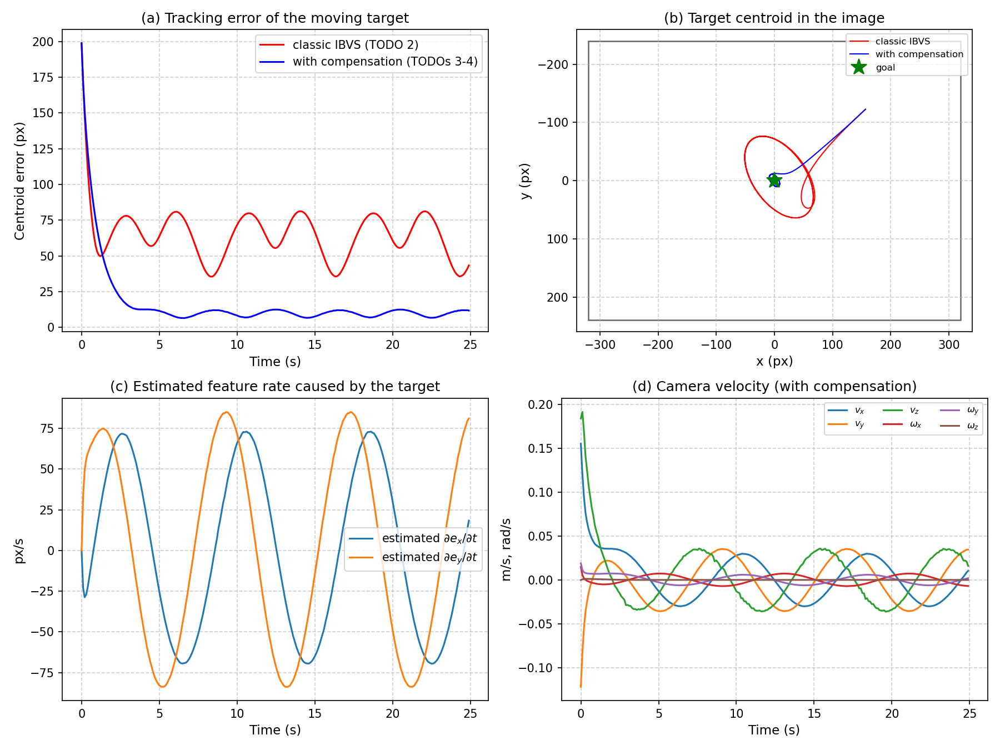
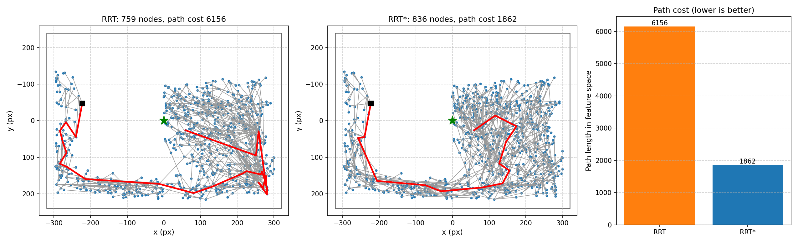

# Assignment 3 — Reference Solution

Eye-in-hand visual servoing and image-space path planning with a UR5 robot, as covered in the lectures on
**Visual Servoing** and **RRT**. This repository contains the complete solution of Assignment 3. Use it to
check your own implementation.

## The four tasks

A camera on the UR5's end-effector must bring a target to the image centre with a desired size,
`s* = [0, 0, 3000]` (centroid x, y and area in pixels).

| Task | What happens | Solution of |
|:---|:---|:---|
| 1 IBVS, static target | Classic IBVS `v = −λ L⁺ e` servos the camera to `s*` | TODO 1 `kinematics.py` → `InteractionMatrix.compute`, TODO 2 `ibvs.py` → `ibvs_camera_velocity` |
| 2 IBVS, moving target | The target moves on a circle. Classic IBVS lags behind; estimating the target's motion and compensating for it removes most of the lag | TODO 3 `ibvs.py` → `estimate_target_motion`, TODO 4 `ibvs.py` → `compensated_camera_velocity` |
| 3 Image-space RRT | Classic IBVS drives the arm straight into a pillar. An RRT in image space plans a path around it, which trajectory-tracking IBVS then follows | TODO 5 `planner.py` → `_extend`, TODO 6 `visualizer.py` → `draw_rrt_tree` |
| 4 Image-space RRT* | Same kind of problem with a wall: RRT* chooses the cheapest parent and rewires the tree, giving a much shorter path than RRT | TODO 7 `planner.py` → `_choose_parent`, TODO 8 `planner.py` → `_rewire` |

Each solution sits directly below its `TODO n` comment block, the same block as in the assignment.

## Setup and running

```bash
python3 -m venv .venv
source .venv/bin/activate        # Windows: .venv\Scripts\activate
pip install -r requirements.txt

python -m unittest -v            # all tests pass
python main.py --task1           # with GUI: camera view, robot, live RRT tree
python main.py --task2
python main.py --task3
python main.py --task4
python main.py --all --headless  # everything without windows (about 2 minutes)
```

Outputs go to `results/<task>/`, with a summary in `results/summary.md`.
`results_reference/` holds the outputs of the run shown below.

## Results

| Task | Result |
|:---|:---|
| 1 | error 1563 px → 3 px in 10 s (below 10 px after 6.3 s) |
| 2 | steady tracking error 62 px (classic) → 9.7 px (compensated) |
| 3 | classic IBVS collides with the pillar after 3 steps; the RRT path (planned in 2.7 s) reaches the goal with 0 collisions and at least 3.0 cm clearance |
| 4 | path cost 6156 (RRT) → 1862 (RRT*); the RRT* path takes 13 s instead of 43 s, with 0 collisions |

| Task 2: classic vs compensated | Task 4: RRT vs RRT* |
|:---:|:---:|
|  |  |

Task 3: classic IBVS (top) and the RRT path (bottom)


